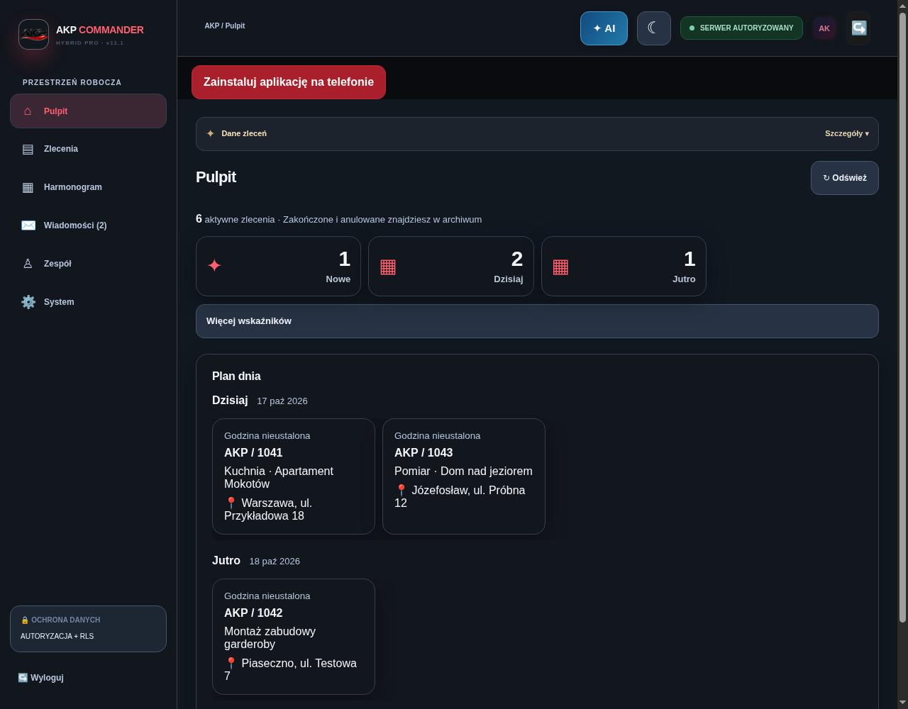
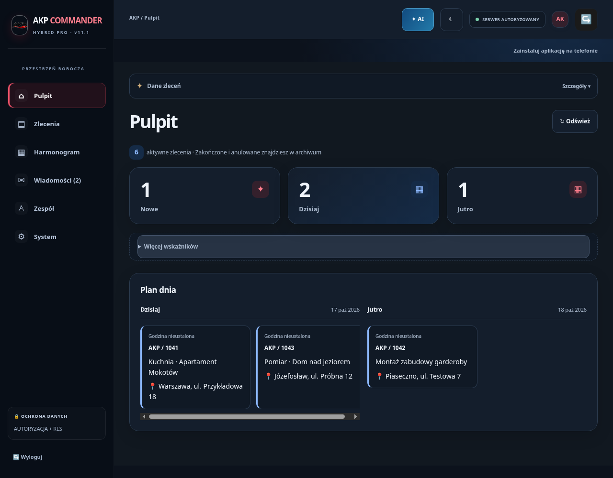
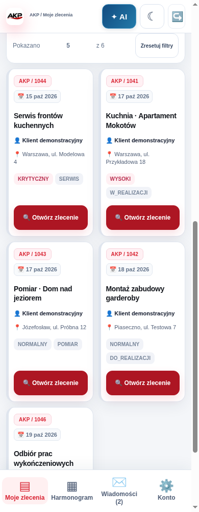
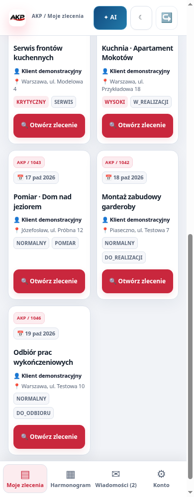

# AKP Premium v02 — podgląd i dokumentacja

Warstwa wizualna istniejącego AKP Commander na gałęzi `feat/akp-visual-supersprint-02-v01`, baza `32a51e1`. Nie zmieniono public/app.js, public/chat.js, server.js, backendu/API, SQL ani migracji SUPERSPRINT 01. Bez deploy i merge.

## Podgląd i porównanie

Wygenerowany plik `artifacts/visual-sprint-02/AKP_PREMIUM_BEFORE_AFTER.html` zawiera **80 osadzonych screenshotów** i działa bez zewnętrznych zasobów. Można wybrać panel, motyw, szerokość oraz widok i pobrać osobny PNG. Wraz z `manifest.json` jest publikowany wyłącznie jako artifact CI, nie jako strona akp.wtf. Lokalny plik jest też przygotowany do pobrania przez użytkownika.

To zrzuty rzeczywistego app.js/chat.js na fikcyjnym API, bez możliwości wykonania zapisu. „Przed” wyłącza tylko nowy arkusz na identycznych danych i odpowiada warstwie startowej 32a51e1. „Po” włącza arkusz v02. Ujęcia listy zleceń są przewinięte do kart. Oznaczenia godzin nie są dodawane do danych.

Galeria została sprawdzona w Chromium: filtry, rozdzielenie ról, obrazy i linki pobierania działają po zablokowaniu całego HTTP(S). Zarządzany runtime blokuje samo otwarcie file://, dlatego w teście pojedynczy dokument udostępniono wewnętrznie, a następnie odcięto sieć. Nie tworzono publicznego podglądu ani linku loopback dla użytkownika.

### Pulpit / Premium Dark — przed i po




### Monter / 390 px / Premium Light — przed i po




## Architektura Design Systemu

`public/akp-premium-v02.css` jest ładowany na końcu istniejącego index.html. Selektory są odizolowane pod `#appView`; nie importowano globalnego CSS Claude i nie zmieniano logowania ani publicznego landingu. Zachowano istniejące kontrolki, etykiety i data-* oraz ich zdarzenia. Widoczność finansów nadal zależy od backendu/RLS/roli, a nie od CSS.

Tokeny semantyczne `--v-canvas/surface/soft/ink/muted/line/red/blue/focus` mapują się do istniejących tokenów `--u-*` i `--akp-*`. Dark: neutralny granat, jasna typografia, czerwone akcenty AKP, niebieski AI/informacji. Light: jasne powierzchnie i ten sam ciemny sidebar. Bez zależności od zewnętrznych fontów/CDN. Typografia systemowa, tabularne liczby, spójne promienie i odstępy.

Rozdzielono stany primary/secondary/active/error/empty/disabled/focus. Główne kontrolki mają 48px, pomocnicze chips minimum 44px; metryka QA wykrywa buttony <43px (brak takich w macierzy). Ruch jest subtelny; przy prefers-reduced-motion animacje i przejścia w appView są wyłączone. Nie dodano efektów parallax, nie zmieniono logiki funkcji.

Układ: karty zleceń 2 kolumny na 390px, 3 na 1280px, 4 od 1600px. Plan Dzisiaj/Jutro wykorzystuje dwie kolumny. Formularze, Zespół i rozmowy na małym ekranie pozostają czytelną pojedynczą kolumną. Kalendarz grupuje dni i zachowuje istniejącą edycję dat, bez wymyślania godzin.

## Powtarzalna walidacja

```bash
npm run check
npm run build
npm test
node scripts/qa-real-panels.mjs
node scripts/qa-chat.mjs
node scripts/qa-supersprint.mjs
node scripts/qa-visual-sprint.mjs
node scripts/build-visual-gallery.mjs
node scripts/qa-visual-gallery.mjs
```

Wymagania: Node >=20, Chrome/Chromium (`CHROME_BIN` opcjonalny); istniejące zależności. Testy używają lokalnego serwera i tylko fikcyjnych kont/zleceń. Nie potrzebują sekretów ani Supabase. Wynik: **324/324 PASS**, actual panele/chat/sprint01 PASS, osiem kombinacji 390/1280 × Light/Dark × coordinator/worker PASS, 40 widoków i 80 obrazów. Sprawdzono brak overflow, finanse/uprzywilejowane requesty workera, układ kolumn, reprezentatywny kontrast tekstu (minimum **4.79:1**), buttony, reduced-motion oraz stany pustej listy i błędu 503.

To walidacja viewportów Chromium i stylów, nie fizyczny Android/TalkBack ani pełna certyfikacja WCAG. Kontrast jest obliczony dla wybranych tekstów i ich tła; nie zastępuje audytu każdego piksela gradientu, obrazu i wszystkich stanów. Regresja finansów jest dodatkowa — CSS nie jest granicą autoryzacji.

CI zapisuje pełną galerię i PNG jako `AKP_VISUAL_SUPERSPRINT_02_BEFORE_AFTER`; lokalnie pliki generowane są ignorowane. Wybrane cztery dowody PNG są wersjonowane w docs/visual-sprint-02/.

## Źródła i dalsze prace

Rzeczywiście odczytano repo oraz PR #8 Design40 (`4ce7937`); obecny kod miał już prawie wszystkie te elementy. Zachowano Unified i integrację V19. Dokumentów Drive i ZIP Claude UI v07, grafiki koncepcyjnej oraz Gemini NEXT nie odczytano; nie deklarujemy ich implementacji. Uporządkowany backlog: VISUAL_SUPERSPRINT_02_BACKLOG.md (Claude/Gemini, Wyceny PRO, DrawingCanvas, dalsze V19, ikony i audyt fizycznych urządzeń).

## Review, uruchomienie i rollback

Po przygotowaniu zwykłych zależności istniejąca aplikacja nadal uruchamia się przez `npm run dev`; nie zmieniono konfiguracji ani usług. Nowe style nie wymagają SQL, nowych zmiennych lub sekretów. Zewnętrzne bramki funkcjonalne sprintu 01 (nowy chat/audit REVIEW_ONLY) pozostają bez zmian — mock preview nie jest dowodem ich aktywacji w produkcji.

Draft PR powinien być skierowany do `feat/akp-supersprint-01-v01`, nie do main. Opis: VISUAL_SUPERSPRINT_02_PR.md. GitHub API pozostaje ograniczeniem utworzenia PR; push nowej gałęzi jest potwierdzany oddzielnie. Nie scalać ani nie publikować bez zgody właściciela.

Rollback prezentacji: osobny commit usuwający link do akp-premium-v02.css z index.html przywraca poprzednie style; nie usuwa funkcji, danych ani historii. Nie używać reset --hard na gałęzi z pracą użytkownika i nie cofać migracji/security. Zmiany wdrożeniowe wymagają osobnego zatwierdzenia; żadnego deploy nie uruchomiono.
